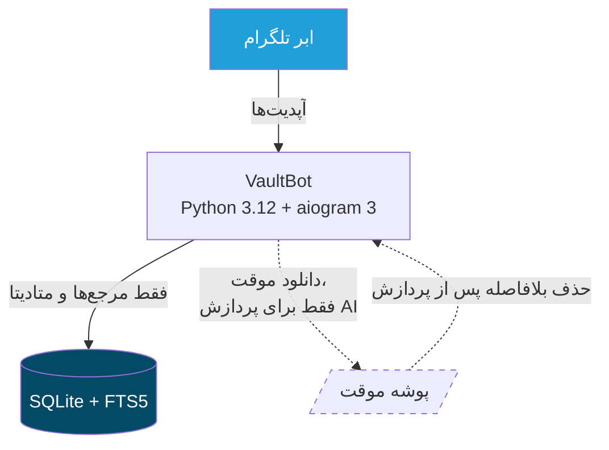

<div dir="rtl">

# VaultBot

🇬🇧 [English README](README.md)

**گاوصندوق شخصی تلگرام — حریم‌خصوصی‌محور و کم‌مصرف‌ترین حالت ممکن.**
هر چیزی بفرستید (متن، لینک، عکس، سند، صدا، ویدیو، استیکر، پیام فورواردی)؛
والت‌بات آن را در یک صندوق منظم، قابل جستجو و قابل مدیریت ذخیره می‌کند:
تگ، پوشه، یادداشت، علاقه‌مندی، یادآور و تشخیص تکراری — با **تقریباً صفر
مصرف دیسک**.


---

## معرفی

«پیام‌های ذخیره‌شده» (Saved Messages) تلگرام ساده است: فقط انبار می‌کند.
**VaultBot نسخه‌ای هوشمندتر و قابل‌جستجو‌تر از Saved Messages** است که برای
ذخیره و مدیریت واقعی محتوا طراحی شده: به‌جای یک لیست بی‌نظم، آیتم‌ها با
متن کامل قابل جستجو هستند (FTS5)، با تگ و پوشه سازمان‌دهی می‌شوند، یادداشت
و یادآور می‌گیرند و فایل تکراری به‌طور خودکار شناسایی و رد می‌شود.

نکتهٔ کلیدی طراحی: تلگرام خودش فایل‌های شما را برای همیشه در ابر نگه
می‌دارد. یک ربات معمولی آن‌ها را دوباره دانلود و روی سرور کپی می‌کند؛ اما
VaultBot فقط **مرجع‌ها (`file_id`) و متادیتا** را در یک دیتابیس SQLite بسیار
کوچک نگه می‌دارد. نتیجه: جستجو و مدیریت روی فضای ذخیره‌سازی خود تلگرام،
بدون اشغال دیسک و بدون کپی دوم از فایل‌های شما.

## قابلیت‌ها

همهٔ موارد زیر در کد پیاده‌سازی شده‌اند و با تست پوشش داده شده‌اند:

- 📥 **ذخیرهٔ هر چیزی**: متن، لینک، عکس، ویدیو، سند، صوت، پیام صوتی، گیف،
  استیکر و پیام‌های فورواردی
- 🔎 **جستجوی متن کامل** (FTS5) روی نام فایل، کپشن، متن، یادداشت، تگ‌ها و
  خلاصه‌ها — فارسی و انگلیسی، با نتایج صفحه‌بندی‌شده و قابل کلیک
- 🔗 **بازیابی مدیا**: بازفرستادن هر فایل ذخیره‌شده در هر زمان، فقط با
  `file_id` ذخیره‌شده — بدون دانلود روی سرور
- 🏷 **تگ‌ها** و نمای کلی تگ‌ها؛ پیشنهاد تگ با AI فقط در صورت پیکربندی ارائه‌دهندهٔ AI
- 📁 **پوشه‌ها** با انتخابگر اینلاین و `/move`
- 📝 **یادداشت**: یادداشت خصوصی و قابل جستجو برای هر آیتم
- ⭐ **علاقه‌مندی‌ها** با دکمهٔ تغییر وضعیت و `/favorites`
- ⏰ **یادآورها** (`+30m`، `14:30`، `فردا 08:00`، `2026-12-01 09:00`)
- 🔁 **تشخیص فایل تکراری** با `file_unique_id`
- 🕓 **دسترسی سریع**: `/recent` و `/random`
- 🗑 **حذف نرم / بازگردانی** + پاک‌سازی دائمی با `/emptytrash`
- 💾 **پشتیبان‌گیری** خودکار و دستی از دیتابیس، با چرخش و تأیید سلامت
- 💽 **`/storage`**: گزارش لحظه‌ای و واقعی از مصرف دیسک
- 🤖 **AI اختیاری** (خلاصه‌سازی) پشت یک واسط ارائه‌دهنده — ربات بدون هیچ
  کلید API کاملاً کار می‌کند
- 🔒 **جداسازی کامل کاربران** — در لایهٔ دیتابیس اعمال می‌شود

## مدل ذخیره‌سازی

اصل اول: **فایل‌های مدیا به‌صورت دائمی روی VPS ذخیره نمی‌شوند.** عکس‌ها،
ویدیوها، اسناد و صداها در ابر تلگرام می‌مانند و ربات فقط مرجع آن‌ها را ثبت
می‌کند. تنها دادهٔ ماندگار روی دیسک، دیتابیس SQLite (چند مگابایت حتی برای
هزاران آیتم) و چند نسخهٔ پشتیبان چرخشی است.

هر شناسه دقیقاً چه نقشی دارد:

| دادهٔ ذخیره‌شده | چیست؟ | کاربرد در VaultBot |
|---|---|---|
| `file_id` | دستگیرهٔ تلگرام برای **استفاده** از فایل: رشته‌ای بلند که به ربات دریافت‌کننده وابسته است و در `sendPhoto`/`sendDocument`/… و `getFile` به کار می‌رود. تلگرام ممکن است در بازه‌های خیلی طولانی این مقدار را تغییر دهد. | **بازیابی مدیا**: بازفرستادن فایل ذخیره‌شده در هر زمان، بدون دانلود آن روی سرور. |
| `file_unique_id` | شناسهٔ کوتاه و **پایدار** برای خود *محتوای* فایل: فایل یکسان = شناسهٔ یکسان (حتی بین ربات‌های مختلف). با آن **نمی‌توان** فایل را دانلود یا ارسال کرد. | **فقط تشخیص تکراری**: ارسال دوبارهٔ یک فایل شناسایی و رد می‌شود. هرگز برای بازیابی استفاده نمی‌شود. |
| `message_id` / `source_chat_id` | پیام و چتی که محتوا از آن آمده. | نمایش متادیتای منبع در صفحهٔ جزئیات آیتم (مثلاً برای فورواردی‌ها) و مرجع پشتیبان. |
| متادیتا | نوع، نام فایل، `mime_type`، حجم، کپشن، متن، تگ‌ها، یادداشت، خلاصه، پوشه، زمان‌ها، پرچم علاقه‌مندی و حذف | سازمان‌دهی، نمایش و آمار — همه در جدول `items` به‌صورت مقادیر کوچک. |
| ایندکس FTS5 | ایندکس جستجوی تمام‌متنی SQLite (`items_fts`) روی نام فایل، کپشن، متن، یادداشت، تگ و خلاصه — از نوع **بدون محتوا** (`content=''`) تا فقط ایندکس ذخیره شود نه کپی متن. | `/search` سریع؛ همگام‌سازی ایندکس در لایهٔ ریپازیتوری روی هر درج/بروزرسانی/حذف. |

**تفاوت `file_id` و `file_unique_id` در یک جمله:** با `file_id` می‌توان فایل
را **استفاده** کرد (دوباره فرستاد)؛ با `file_unique_id` می‌توان فایل را
**شناخت** (تکراری را گرفت) — والت‌بات هر کدام را دقیقاً برای همان هدف به
کار می‌برد.

اگر قابلیتی واقعاً به محتوای فایل نیاز داشته باشد (مثلاً خلاصه‌سازی
اختیاری با AI)، فایل در پوشهٔ موقت `/tmp` دانلود، پردازش و **بلافاصله حذف**
می‌شود — حتی اگر پردازش وسط کار کرش کند — و یک پاک‌ساز دوره‌ای هم
باقی‌مانده‌های احتمالی را حذف می‌کند.

## معماری

تک‌پروسه، تک‌دیتابیس. بدون Redis، بدون PostgreSQL، بدون Elasticsearch و بدون
میکروسرویس.



```
vaultbot/
├── app/
│   ├── main.py            # نقطهٔ ورود + حلقه‌های پس‌زمینه
│   ├── bot.py             # ساخت بات و دیسپچر
│   ├── config.py          # تنظیمات مبتنی بر متغیرهای محیطی
│   ├── ai/                # واسط AIProvider: null / mock / openai
│   ├── db/                # schema.sql، اتصال بهینه‌شدهٔ WAL، ریپازیتوری
│   ├── handlers/          # ذخیره، جستجو، پوشه، تگ، یادداشت، حذف،
│   │                      # یادآور، دسترسی سریع، کال‌بک‌ها، حالت‌های FSM
│   ├── keyboards/         # سازنده‌های کیبورد اینلاین
│   ├── services/          # ذخیرهٔ آیتم، بازیابی مدیا، پایپ‌لاین AI، بکاپ،
│   │                      # پاک‌سازی، مصرف فضا، پارس زمان، تسک‌ها
│   └── utils/             # ابزارهای متنی، صفحه‌بندی، متن‌های رابط کاربری
├── tests/                 # تست‌های آفلاین (بدون توکن / بدون شبکه)
├── data/                  # دادهٔ اجرا (در گیت نادیده گرفته می‌شود)
├── Dockerfile
└── docker-compose.yml
```

## نصب و اجرا

پیش‌نیاز: **پایتون ۳.۱۲ یا جدیدتر** (همراه SQLite ≥ 3.43 که برای قابلیت
`contentless_delete` در FTS5 لازم است).

### روش لوکال

```bash
# ۱. وابستگی‌ها
git clone <repository-url> vaultbot && cd vaultbot
python -m venv .venv
source .venv/bin/activate        # ویندوز: .venv\Scripts\activate
pip install -r requirements.txt

# ۲. ساخت فایل محیطی
cp .env.example .env             # ویندوز: copy .env.example .env

# ۳. قرار دادن BOT_TOKEN (از @BotFather) در فایل .env

# ۴. اجرا
python -m app.main
```

### روش داکر

```bash
cp .env.example .env             # مقداردهی BOT_TOKEN
docker compose up -d --build
docker compose logs -f
```

فقط مسیر `./data` (دیتابیس + پشتیبان‌ها) مونت می‌شود؛ محدودیت حافظهٔ ۲۵۶
مگابایت و چرخش لاگ داکر در `docker-compose.yml` تنظیم شده است. نمونهٔ کامل
متغیرهای محیطی در [`.env.example`](.env.example) موجود است؛ تنها متغیر
الزامی `BOT_TOKEN` است و ربات بدون کلید AI هم کاملاً کار می‌کند
(`AI_PROVIDER=none` پیش‌فرض است).

## دستورات ربات

| دستور | توضیح |
|---|---|
| *(فرستادن هر چیزی)* | ذخیره می‌شود؛ یک کارت تمیز با دکمه‌های عملیات می‌گیرید |
| `/search <عبارت>` | جستجوی تمام‌متنی با نتایج قابل کلیک و صفحه‌بندی |
| `/recent` | آخرین آیتم‌ها (صفحه‌بندی‌شده) |
| `/random` | یک آیتم تصادفی از صندوق شما |
| `/favorites` | آیتم‌های ستاره‌دار |
| `/fav [id]` | تغییر وضعیت ⭐ (پیش‌فرض: آخرین آیتم) |
| `/tag [id] #tag…` / `/untag [id] #tag…` / `/tags` | مدیریت تگ‌ها |
| `/note [id] <متن>` | افزودن یادداشت |
| `/folders` / `/newfolder [نام]` / `/move [id] [پوشه]` | مدیریت پوشه‌ها |
| `/remind [id] <زمان>` | یادآور روی آیتم |
| `/reminders` | لیست یادآورهای فعال |
| `/delete [id]` / `/restore [id]` | حذف نرم / بازگردانی |
| `/emptytrash` | پاک‌سازی دائمی آیتم‌های حذف‌شده (+ VACUUM) |
| `/stats` | آمار صندوق |
| `/storage` | گزارش واقعی مصرف دیسک |
| `/settings` | پیکربندی فعلی |
| `/backup` | پشتیبان‌گیری دستی از دیتابیس |
| `/dbinfo` / `/vacuumdb` | اندازهٔ دیتابیس / فشرده‌سازی دستی |
| `/help` / `/start` / `/cancel` | راهنما و کنترل جریان |

دستورهایی که شمارهٔ آیتم نگیرند، روی **آخرین آیتم ذخیره‌شده** عمل می‌کنند.
صفحهٔ جزئیات هر آیتم هم همهٔ عملیات را به‌صورت دکمهٔ اینلاین دارد.

## تست‌ها

```bash
pip install -r requirements-dev.txt
pytest
```

کل تست‌ها کاملاً **آفلاین** اجرا می‌شوند — بدون توکن ربات و بدون شبکه
(نشست تلگرام ماک شده است). پوشش: جریان ذخیره، تشخیص تکراری، جستجوی FTS
(فارسی/انگلیسی)، جداسازی کاربران، بازیابی مدیا بعد از شبیه‌سازی ری‌استارت،
مرجع‌های نامعتبر/حذف‌شده/کاربر دیگر، تگ، پوشه، یادداشت، علاقه‌مندی،
حذف/بازگردانی، پاک‌سازی سطل، یادآورها و پارس زمان، صفحه‌بندی جستجو، ایمنی
بکاپ و چرخش آن، سقف پاک‌سازی فایل موقت، گزارش مصرف فضا، مهاجرت دیتابیس
نسخه‌های قدیمی و جریان‌های کامل از سطح دیسپچر.

**نتیجهٔ فعلی: ۶۴ تست، همه موفق** — برای اطمینان خودتان `pytest` را اجرا کنید.

## محدودیت‌ها

محدودیت‌های واقعی پروژه (با صداقت):

- **احتمال تغییر `file_id` در بازه‌های خیلی طولانی توسط تلگرام** وجود دارد؛
  در آن حالت نادر، بازیابی مدیا وضعیت `api_error` برمی‌گرداند (مدیریت‌شده،
  بدون کرش).
- کوئری صفحه‌بندی جستجو در حافظهٔ همان پروسس نگه داشته می‌شود؛ بعد از
  ری‌استارت ربات، `/search` باید دوباره اجرا شود (برای معماری تک‌پروسه‌ای
  کافی است).
- خلاصه‌سازی اسناد، فعلاً متن خام را می‌خواند؛ پارسر PDF و OCR فقط نقطهٔ
  اتصال دارند و جزو نقشهٔ راه هستند، نه پیاده‌سازی فعلی.
- رابط کاربری ربات فعلاً فقط فارسی است (متن‌ها در یک فایل متمرکز‌اند و
  چندزبانه‌شدن در نقشهٔ راه است).
- ربات تک‌پروسه است؛ برای چند پروسس/چند سرور به ذخیره‌ساز حالت مشترک نیاز
  دارد که در محدودهٔ طراحی فعلی نیست.

## نقشه راه

موارد زیر فقط **برنامهٔ آینده** هستند و در حال حاضر **پیاده‌سازی نشده‌اند**؛
معماری طوری طراحی شده که بعداً قابل افزودن باشند:

- جستجوی معنایی / امبدینگ (جدول اختیاری + هوک ارائه‌دهنده؛ FTS پیش‌فرض می‌ماند)
- OCR و استخراج متن PDF (نقطهٔ اتصال واحد در `services/ai_pipeline.py`)
- تبدیل گفتار به متن برای پیام‌های صوتی (speech-to-text)
- تگ‌گذاری خودکار با AI و خلاصه‌های غنی‌تر (یک جریان پایهٔ پیشنهاد تگ وقتی
  AI فعال باشد وجود دارد)
- استخراج متادیتای لینک‌ها (عنوان/OG)
- داشبورد وب (لایهٔ ریپازیتوری مستقل از ربات است)
- خروجی به فضای ابری (cloud storage)

## امنیت

- **جداسازی کاربران**: همهٔ کوئری‌های ریپازیتوری با `user_id` فیلتر
  می‌شوند؛ خواندن اطلاعات کاربر دیگر هیچ نتیجه‌ای ندارد و بازیابی مدیای
  بین‌کاربری رد می‌شود.
- **مدیریت سکرت‌ها**: رمزها فقط از `.env` / متغیرهای محیطی خوانده
  می‌شوند؛ ربات بدون `BOT_TOKEN` اصلاً بالا نمی‌آید؛ فایل `.env` در
  گیت نادیده گرفته شده و هرگز کامیت نمی‌شود.
- **ایمنی تزریق**: همهٔ کوئری‌ها پارامتریزه هستند؛ ورودی جستجو به توکن‌های
  نقل‌قول‌دارِ بی‌خطر برای FTS5 تبدیل می‌شود؛ بروزرسانی ستون‌ها فقط از
  لیست مجاز عبور می‌کند.
- **حریم‌خصوصی**: متن پیام‌های کاربران هرگز در لاگ ثبت نمی‌شود (فیلتر لاگ +
  سیاست ممنوعیت ثبت محتوا در کد).
- **هیچ فایل خصوصی روی VPS ذخیره نمی‌شود**: فایل‌ها فقط از طریق `file_id`
  مرجع‌دهی شده‌اند؛ دانلودهای موقتِ مربوط به AI در بلوک `finally` حذف و
  به‌صورت دوره‌ای پاک‌سازی می‌شوند.

برای گزارش آسیب‌پذیری [SECURITY.md](SECURITY.md) را ببینید.

## مشارکت و مجوز

برای مشارکت [CONTRIBUTING.md](CONTRIBUTING.md) — خلاصه: ساده نگه دارید،
فایل‌ها را از دیسک دور نگه دارید، تست‌ها را آفلاین و سبز نگه دارید.

مجوز: [MIT](LICENSE)

</div>
