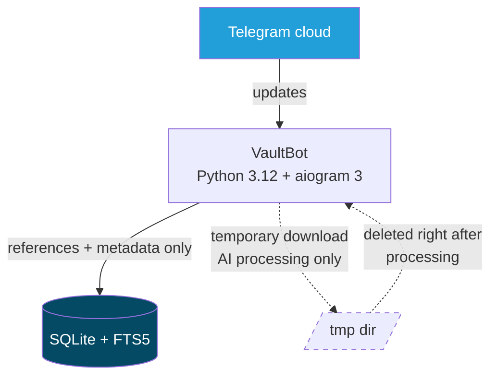

# VaultBot

**A privacy-first, low-storage Telegram personal vault** — an advanced, smarter
replacement for Telegram's *Saved Messages*. Send it anything (text, links,
photos, documents, voice, video, stickers, forwards) and VaultBot stores it in
an organized, searchable vault with tags, folders, notes, favorites, reminders
and duplicate detection — using **almost zero disk space**.

<!--
Static badges below need no repository URL. After the first push to GitHub,
you can add the real CI badge, e.g.:
https://github.com/<OWNER>/<REPO>/actions/workflows/ci.yml/badge.svg
-->


🇮🇷 [نسخه فارسی README](README.fa.md)

---

## Why VaultBot?

Telegram already stores your files — forever, in the cloud. A naive "save bot"
would download and mirror them, burning disk space and creating a second,
unprotected copy of your data.

**VaultBot does the opposite.** Telegram keeps the bytes; VaultBot only keeps
*references* (`file_id`) and *metadata* (name, size, caption, tags, notes) in
a tiny SQLite database. You get search, organization and management on top of
Telegram's own storage — with almost no disk usage and no duplicated files.

## Architecture

Single process, single database. No Redis, no PostgreSQL, no Elasticsearch,
no microservices.



> **Media files are never stored permanently on the VPS.** Photos, videos,
> documents and voice messages stay in Telegram's cloud; VaultBot re-sends
> them later straight from Telegram using the stored `file_id`. The only
> persistent data on disk is the SQLite database and a few rotated backups.
> When a feature genuinely needs file content (e.g. optional AI
> summarization), the file is downloaded to a temp directory, processed and
> deleted immediately — even if processing crashes — and a periodic sweeper
> removes leftovers.

```
vaultbot/
├── app/
│   ├── main.py            # entry point + background loops
│   ├── bot.py             # bot & dispatcher assembly
│   ├── config.py          # env-based settings
│   ├── context.py         # shared AppContext
│   ├── ai/                # AIProvider interface: null / mock / openai
│   ├── db/                # schema.sql, WAL-tuned connection, repository
│   ├── handlers/          # save, search, folders, tags, notes, delete,
│   │                      # reminders, quick actions, callbacks, FSM states
│   ├── keyboards/         # inline keyboard builders
│   ├── services/          # item save, media restore, AI pipeline, backup,
│   │                      # cleanup, storage usage, time parsing, tasks
│   └── utils/             # text helpers, pagination, UI strings
├── tests/                 # offline test suite (no token / no network)
├── data/                  # runtime data (gitignored)
├── Dockerfile
└── docker-compose.yml
```

## Storage Model

VaultBot stores **references and metadata only**. Here is exactly what each
piece is and what it is used for:

| Stored piece | What it technically is | What VaultBot uses it for |
|---|---|---|
| `file_id` | Telegram's handle for *using* a file: a long string tied to the bot that received the file, usable in `sendPhoto`/`sendDocument`/… and `getFile`. Telegram may rotate these values over long periods. | **Media restore**: re-sending a saved file at any later time without downloading it to this server. |
| `file_unique_id` | A short, **stable** identifier of the same file *content*: same file → same unique id. It **cannot** be used to download or send the file, and it is identical across different bots. | **Duplicate detection only**: sending the same file twice is recognized and skipped. It is never used for retrieval. |
| `message_id` / `source_chat_id` | The message and chat the content came from. | Source metadata shown on the item detail page (best-effort, e.g. for forwards); fallback reference. |
| metadata | `type`, filename, `mime_type`, `file_size`, caption, text, tags, note, summary, folder, timestamps, favorite flag, soft-delete flag | Organization, display, statistics — all plain small values in the `items` table. |
| FTS5 index | SQLite full-text index (`items_fts`) over filename, caption, text, note, tags, summary. Created as a **contentless** table (`content=''`, `contentless_delete=1`): it stores only the inverted index, not a copy of the text. | Fast `/search`, kept in sync explicitly by the repository layer on every insert/update/delete. |

**`file_id` vs `file_unique_id` in one sentence:** `file_id` lets you *use*
the file (send it again); `file_unique_id` lets you *recognize* the file
(deduplicate) — VaultBot uses each strictly for that purpose.

Nothing file-shaped ever lands on disk; the only persistent data is the SQLite
database (a few MB even for thousands of items) plus rotated backups.

## Features

Everything below is implemented and covered by the test suite:

- 📥 **Save anything**: text, links, photos, video, documents, audio, voice,
  GIFs, stickers, forwarded messages
- 🔎 **Full-text search** (FTS5) over filename, caption, text, notes, tags,
  summaries — English & Persian, clickable paginated results
- 🔗 **Media restore**: re-send any saved file later via its stored `file_id`
- 🏷 **Tags** and tag overview; optional AI tag suggestions when an AI
  provider is configured
- 📁 **Folders** with inline picker and `/move`
- 📝 **Notes**: private searchable note per item
- ⭐ **Favorites** with toggle button and `/favorites`
- ⏰ **Reminders** (`+30m`, `14:30`, `فردا 08:00`, `2026-12-01 09:00`)
- 🔁 **Duplicate detection** by `file_unique_id`
- 🕓 **Quick actions**: `/recent`, `/random`
- 🗑 **Soft delete / restore** + `/emptytrash` permanent purge
- 💾 **Backups**: automatic + manual, rotated, verified with `quick_check`
- 💽 **`/storage`**: live report of real disk usage
- 🤖 **Optional AI** summarization behind a provider interface — the bot is
  fully functional with no API key
- 🔒 **Strict per-user isolation** enforced in the data layer

## Commands

| Command | Description |
|---|---|
| *(send anything)* | Saves it; you get a clean card with action buttons |
| `/search <query>` | Full-text search with clickable, paginated results |
| `/recent` | Your latest items (paginated) |
| `/random` | A random item from your vault |
| `/favorites` | Your starred items |
| `/fav [id]` | Toggle ⭐ favorite (defaults to last item) |
| `/tag [id] #tag…` / `/untag [id] #tag…` / `/tags` | Manage tags |
| `/note [id] <text>` | Attach a note |
| `/folders` / `/newfolder [name]` / `/move [id] [folder]` | Folder management |
| `/remind [id] <time>` | Reminder on an item |
| `/reminders` | List active reminders |
| `/delete [id]` / `/restore [id]` | Soft delete / restore |
| `/emptytrash` | Permanently purge deleted items (+ VACUUM) |
| `/stats` | Vault statistics |
| `/storage` | Real disk usage report |
| `/settings` | Current configuration |
| `/backup` | Manual database backup |
| `/dbinfo` / `/vacuumdb` | DB size info / manual compaction |
| `/help` / `/start` / `/cancel` | Help & flow control |

Commands without an explicit item id act on your **last saved item**. Every
item's detail page also offers all actions as inline buttons.

## Quick Start

```bash
# 1. dependencies
git clone <repository-url> vaultbot && cd vaultbot
python -m venv .venv
source .venv/bin/activate        # Windows: .venv\Scripts\activate
pip install -r requirements.txt

# 2. environment
cp .env.example .env               # Windows: copy .env.example .env
# 3. put your BOT_TOKEN (from @BotFather) into .env

# 4. run
python -m app.main
```

Or with Docker:

```bash
cp .env.example .env               # set BOT_TOKEN
docker compose up -d --build
docker compose logs -f
```

Requirements: **Python 3.12+** (ships SQLite ≥ 3.43, needed for FTS5
`contentless_delete`).

## Environment Variables

Complete sample in [`.env.example`](.env.example):

| Variable | Default | Description |
|---|---|---|
| `BOT_TOKEN` | — | **Required.** Token from @BotFather |
| `DATA_DIR` | `./data` | Base dir for DB, tmp, backups |
| `DB_PATH` | `./data/vaultbot.db` | SQLite database path |
| `TMP_DIR` | `./data/tmp` | Temp dir for AI downloads (auto-cleaned) |
| `BACKUP_DIR` | `./data/backups` | Backup snapshots |
| `AI_PROVIDER` | `none` | `none` · `openai` · `mock` (key-less demo) |
| `AI_API_KEY` | empty | Only needed for `openai` |
| `AI_MODEL` | `gpt-4o-mini` | Model for the OpenAI-compatible API |
| `AI_MAX_DOWNLOAD_MB` | `25` | Cap for temporary AI downloads |
| `PAGE_SIZE` | `10` | Results per page |
| `TMP_MAX_AGE_MINUTES` | `30` | Age threshold for the temp sweeper |
| `BACKUP_KEEP` | `3` | Number of backups retained |
| `BACKUP_INTERVAL_HOURS` | `24` | Automatic backup interval |
| `LOG_LEVEL` | `INFO` | `DEBUG` … `CRITICAL` |
| `LOG_FILE` | empty | Optional rotating file log (5MB × 3) |
| `ADMIN_IDS` | empty | Reserved for future admin features |

> **Runs with zero AI.** With `AI_PROVIDER=none` (default), summarization and
> tag suggestions are gracefully disabled; everything else works unchanged.

## Testing

```bash
pip install -r requirements-dev.txt
pytest
```

The suite runs fully **offline** — no bot token, no network (the Telegram
session is mocked). It covers the save flow, duplicate detection, FTS search
(English + Persian), user isolation, media restore after a simulated restart,
invalid/deleted/cross-user references, tags, folders, notes, favorites,
delete/restore, trash purge, reminders & time parsing, search pagination,
backup safety & rotation, temp cleanup caps, storage usage, DB migration for
older versions, and end-to-end dispatcher flows.

**Current count: 64 tests, all passing** (run `pytest` to verify).

## Security

- **User isolation**: every repository query is filtered by `user_id`;
  cross-user reads return nothing and cross-user media restore is refused.
- **Secret management**: secrets live only in `.env` / environment variables;
  the app refuses to start without `BOT_TOKEN`; `.env` is git-ignored.
- **Injection safety**: parameterized SQL everywhere; free-text search input
  is sanitized into quoted FTS5 tokens; column updates use an allow-list.
- **Privacy**: logs never contain message content (privacy filter + a strict
  no-content-logging policy in code); only ids/types are logged.
- **No media copies**: files are never persisted locally; temp AI downloads
  are deleted in `finally` blocks and swept periodically.

See [SECURITY.md](SECURITY.md) for vulnerability reporting.

## Storage Constraints

VaultBot is built for **tiny servers** (it was designed against a 5 GB VPS):

- Default disk usage ≈ the SQLite database (a few MB even for thousands of
  items) + ≤ `BACKUP_KEEP` small snapshots.
- Temp files are age-swept **and** size-capped (oldest evicted first).
- SQLite runs in WAL mode with a small page cache; VACUUM is never run on the
  hot path — only manually (`/vacuumdb`) or after `/emptytrash`.
- FTS uses a *contentless* index to keep the search footprint minimal.
- `/storage` shows real, measured numbers at any time.

## Roadmap

The architecture is deliberately ready for these — **none are implemented yet**:

- Semantic search / embeddings (optional table + provider hook; FTS stays default)
- OCR and PDF text extraction (single hook in `services/ai_pipeline.py`)
- Speech-to-text for voice messages
- Richer AI auto-tagging and summaries (a basic suggestion flow exists when AI is enabled)
- Link metadata extraction (titles/OG data)
- Web dashboard (repository layer is bot-agnostic)
- Multi-language UI (strings centralized in `app/utils/messages.py`)
- Cloud-storage export

## Contributing

See [CONTRIBUTING.md](CONTRIBUTING.md). Short version: keep it simple, keep
files off disk, keep tests offline and green.

## License

[MIT](LICENSE)
